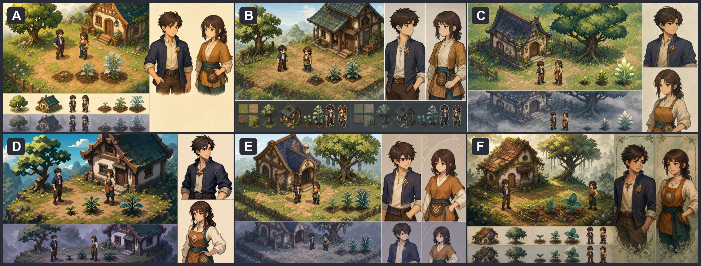
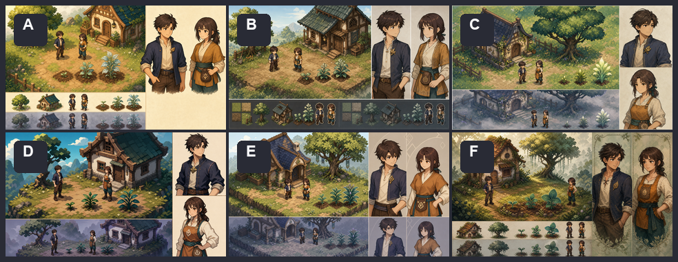
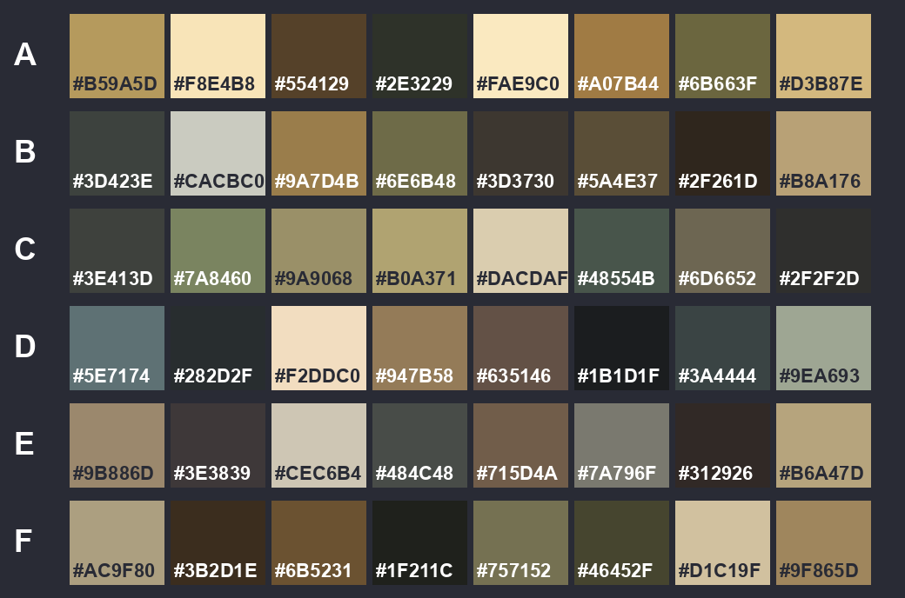

# VISUAL-PILOT-001 第一轮评审

## 结论先行

第一轮已完成 A～F 六张独立候选。六张都保留同一评审内容，但落在三组视觉语言区间：

1. **田居工艺线：A / B**——A 偏温润块面，B 偏织纹木构；
2. **山雾叙事线：C / D**——C 偏清润绘本与空气感，D 偏木刻图形与强轮廓；
3. **魔法生长线：E / F**——E 偏学院几何，F 偏有机生长与柔雾。

这是整理方式，不是自动入围。用户仍可从 A～F 任意选择两个候选。

## 总览

手机缩略预检：

机器提取的综合色板：

色板图从整张概念板自动提取，会受到右侧纸色背景和异常态影响，不是正式运行时色板。

## A：温润块面田居

- 设计重点：圆润大块面、温暖阳光、低至中等像素密度、较亲切的 3.5 头身角色。
- 优点：日常居住感最直接；主角靛青、沈禾琥珀/深青的角色配色在场景和立绘之间容易互认；作物三阶段清楚。
- 风险：草地和树叶的实际生成细节仍比目标更碎；小屋更接近泛欧式木构，东方幻想辨识偏弱；场景树叶缩小后有噪点。
- 32×32 Tile：中等难度，需要大幅减少草花噪点并重新设计边缘、转角和重复变体。
- 96×96 Sprite：低到中等难度，色块清楚，但衣领、黄铜扣和沈禾种子袋需要缩为单一稳定形。
- 微信可读性/性能：角色轮廓良好；静态烘焙时性能风险低，若保留大量独立叶片和花点则图集与变体数量会上升。

## B：织纹木构田园

- 设计重点：较明确的木构节奏、织纹/雕刻母题、略修长的角色轮廓和中等像素密度。
- 优点：六张中“场景 Sprite—立绘—单体资产带”的说明最完整；沈禾的发型、琥珀外搭、深青腰带和种子袋映射清楚；东方幻想更多来自工艺结构而不是发光符文。
- 风险：屋瓦、木梁和衣缘纹样偏密；等距悬台式场景需要回到真正 32×32 TileMap 逻辑；纹样若照搬会在手机端变成噪点。
- 32×32 Tile：中等难度，可拆模块，但必须把纹样提升为跨 2～4 像素的大形并减少地表颗粒。
- 96×96 Sprite：中等难度，主体色块清楚，衣缘纹样与饰扣必须简化。
- 微信可读性/性能：轮廓和配色可读性较好；静态贴图风险低至中等，屋体分层和变体过多会增加纹理内存。

## C：清润绘本像素

- 设计重点：清润春日空气、柔和绘本立绘、中高密度像素簇、同资产下最明显的冷雾异常对照。
- 优点：温暖日常与轻微异常的情绪跨度最自然；人物立绘细腻但仍能与场景配色互认；小屋、树与角色构成稳定。
- 风险：成熟雾叶草被画成强发光植物，超出“成熟可读但不依赖特效”的要求；树冠、花草和石墙细节较重；雾和空气透视若全做实时效果会增加 overdraw。
- 32×32 Tile：高难度，需要把绘本纹理重构为有限色阶和可重复簇，而不是直接缩图。
- 96×96 Sprite：中到高难度，比例可行，但柔和面部和衣物明暗需要重新归纳。
- 微信可读性/性能：角色主色仍可读，小作物初期阶段容易淹没在地表；需要烘焙大部分空气感，只保留一个共享色层和极少雾片。

## D：山雾木刻图形

- 设计重点：木刻式负形、硬朗阶梯边、较高局部对比、3.75～4 头身和中等细节密度。
- 优点：六张中手机轮廓、作物阶段、地面/角色分离最清楚；最容易降到 32×32 Tile 与 96×96 Sprite；异常态在关闭粒子后仍能靠色层和轮廓成立。
- 风险：高山悬台和明亮蓝天让场景略偏冒险据点，长期田园的安静柔和度不如 A/C/F；木构块面较硬，第二轮需验证能否增加生活痕迹而不变碎。
- 32×32 Tile：低到中等难度，地表、石块和树冠都已有较明确的大形逻辑。
- 96×96 Sprite：低到中等难度，轮廓和配色稳定；需确认接近 4 头身时动作弧线仍能留出画布空间。
- 微信可读性/性能：本轮最佳；可主要依赖静态图、假阴影和一个共享异常色层，效果关闭后仍成立。

## E：学院几何乡野

- 设计重点：学院几何母题、拱与菱形构造、较修长角色、克制蓝紫魔法强调。
- 优点：主角“学院背景但适合农务”的识别最强；两名角色的场景与立绘映射清楚；几何母题适合模块化和 UI 延展。
- 风险：小屋入口容易读成学院礼拜堂而不是故乡住宅；树上悬挂装饰和立绘背景菱形属于额外装饰倾向，不能直接带入运行时；菱形叶纹重复过多会压过人物个性。
- 32×32 Tile：中等难度，几何结构易拆，但拱门、屋顶嵌纹和悬挂物需要减少层数。
- 96×96 Sprite：低到中等难度，短外套和围裙色块清楚，饰扣/袋纹必须只保留一个识别符号。
- 微信可读性/性能：轮廓良好；静态性能风险低至中等，悬挂物若动画化会增加节点和透明叠加。

## F：柔雾生长诗性

- 设计重点：最高细节密度、有机生长轮廓、柔雾与刺绣感大形、偏绘画性的立绘。
- 优点：长期生活的温暖、自然生长感和角色亲和力最强；不依赖密集学院符文也能表达魔法乡野；沈禾立绘气质可靠而不幼态。
- 风险：屋顶、藤蔓、树冠、花草与边框装饰同时偏密；小屋略显老旧/过度生长；F 的沈禾袖口有非设定红色绘制痕迹，必须清除；异常对照偏弱。
- 32×32 Tile：高难度，需要从零归纳植被簇、地表边缘和屋顶纹理，不能直接缩放。
- 96×96 Sprite：中到高难度，角色大色块可保留，但刺绣、褶皱和柔和阴影需要显著减少。
- 微信可读性/性能：身体轮廓尚可，环境信息在 320×180 下损失明显；若把雾、垂枝和叶片全部动态化，透明 overdraw 与节点数量风险最高。

## 横向结论

| 候选 | 日常温暖 | 手机轮廓 | 32/96 转换 | Sprite/立绘一致性 | 同资产异常 | 主要问题 |
| --- | --- | --- | --- | --- | --- | --- |
| A | 很强 | 良好 | 中等 | 良好 | 良好 | 东方幻想偏弱、草叶偏碎 |
| B | 强 | 良好 | 中等 | 很强 | 良好 | 织纹和屋体细节偏密 |
| C | 很强 | 中等 | 较难 | 良好 | 很强 | 发光作物、雾效和纹理成本 |
| D | 中等偏强 | 很强 | 最容易 | 良好 | 很强 | 田园柔和度不足、略偏冒险据点 |
| E | 强 | 很强 | 较容易 | 很强 | 良好 | 学院感压过住宅感、符号重复 |
| F | 很强 | 中等 | 最难 | 很强 | 中等 | 细节/overdraw 高、袖口随机瑕疵 |

## 推荐但不代替用户确认

建议优先考虑 **D** 作为后续正式视觉方向的技术基线：它最符合 32×32 Tile、96×96 Sprite、Nearest 缩放和 `wechat-low` 关闭效果仍可读的硬约束，同时已经具备区别于常见农场像素画的木刻式图形语言。

如果第二轮选择 D，应重点修正“过于高山冒险、生活痕迹不足”；这只是推荐，不把 D 标记为入围或确认。

## 角色比例与一致性

- A/C/F 偏 3.25～3.5 头身，亲和、生活化，但动作与工具轮廓需要额外留白；
- B 偏 3.5～3.75 头身，人物识别与服装信息较均衡；
- D/E 偏 3.75～4 头身，手机轮廓最好，但 96×96 内工具动作空间更紧。

所有候选都较稳定地保留了同一组识别锚点：男性主角的深色短发、靛青短外套和黄铜叶形学院扣；沈禾的深栗低束发、琥珀短围裙、米白内层、深青腰带裤装和居中种子袋。第一轮只验证映射方法，不确认主角或沈禾的最终造型。

## 色板说明

- 共同语义仍遵循项目基线：绿色草地、暖棕泥土、蜂蜜/琥珀生活焦点、靛青学院色、蓝灰/灰紫异常覆盖、左上主光。
- A/B 的综合色偏黄绿、胡桃木和亚麻，适合温暖日常；
- C/D 的综合色偏雾绿、矿物青和深木色，异常态对比更有力；
- E 的靛青/奶油/铜色最利于建立学院—乡野共享母题；
- F 的苔绿/梅灰/琥珀最有机，但必须减少中间色和细纹。
- `visual-pilot-001-r1-palette-overview.png` 只是对完整候选板自动量化的八色样本，不能直接作为 Sprite 限色板。

## 下一轮必须保持的闸门

用户需明确选择两个编号。之后每个入围方向各生成至少 3 张优化变体，并保持角色、场景内容、基本构图和异常对照一致。未完成第二轮确认前，不生成五套主角造型、五套沈禾造型，也不开始沈禾表情差分。
