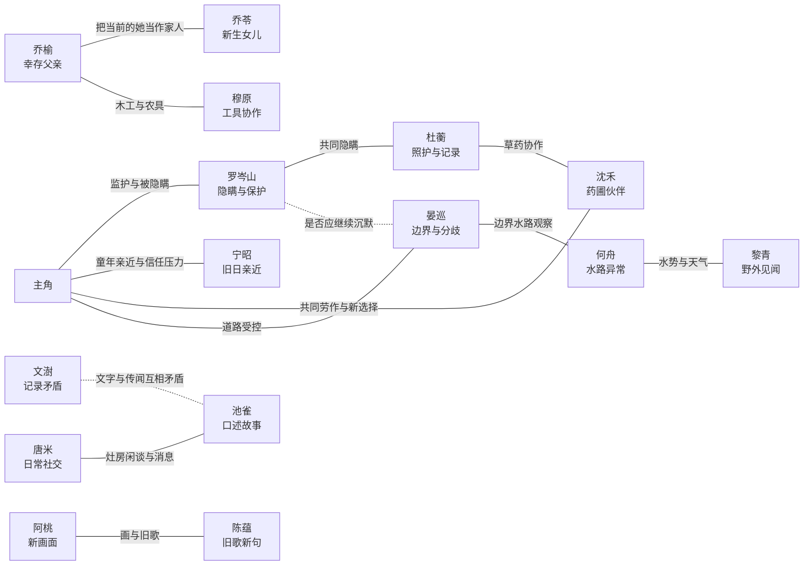

# 《雾乡如昨》NPC 设定基线

> 内部剧透文档。本文件包含幸存者、重构村民、知情程度和隐瞒立场。玩家可见角色数据不得直接复制内部分类。

## 文档职责

本文件是阶段 10C 的 NPC 名单、内容预算、地图锚点和关系预览权威文档。它回答“Demo 里有哪些人、玩家先看到什么、每个人做到多深”，但不在本阶段编写完整个人线、正式对白、角色美术、立绘、配音或主题音乐。

稳定规则：

- Demo 固定 15 名 NPC：5 名幸存者、10 名重构村民。
- 主角在记忆中认识这些村民。第一章是“主角重逢、玩家初识”，不是主角逐个与陌生人初次见面。
- 重构村民继承记忆原型的关系起点，但他们在第一章后的感情与选择属于当前的新生命。
- 幸存者/重构村民分类、知情层级和隐瞒动机只存在于内部叙事资料，不进入公开 `characters.json`。
- 当前 15 名以及未来加入正式角色目录的每一名可交谈 NPC，全部拥有可升可降的好感记录；内容层级只控制专属对白和事件深度，不关闭任何人物的好感能力。
- 完整产品允许男性或女性主角与符合条件的任意性别 NPC 同时发展多条恋爱关系，但结婚时只能选择一名配偶；恋爱只能由告白被接受后确立，求婚只能在恋爱对象满好感后开放，二者都不能只靠数值自动发生。
- Demo 只给少数人物较深内容；全员好感不等于全员个人线、十一名开场成年告白对象与未来成年对象的完整恋爱线、婚姻内容或全员八状态立绘。
- 正式美术、立绘、配音与角色音乐必须按 `docs/RESOURCE_CREATION_WORKFLOW.md` 在独立任务中制作。本阶段只提供未来资源输入简报。

## 关系连续性

### 既有关系记忆

主角记得袭击前与村民的关系。重构村民也把记忆原型中的共同经历视为自己的过去，因此对白应自然包含熟悉感、旧称呼和共同习惯，不能使用“初次见面”模板。

既有关系记忆只决定对白语境，不直接等于玩家在当前存档赚取的好感值。它不能让角色自动爱上主角，也不能替玩家作出亲密选择。

### 新生关系

第一章开始后，玩家与当前人物实际经历的选择、冲突、信任和感情属于新生关系。未来关系存档必须把“过去为何熟悉”的语境与“本存档实际发展到哪里”分开，避免重构村民被写成只能重复旧关系的替代品。

## 内容层级

| 层级 | 人数 | Demo 内容预算 | 正式立绘预算 | 非目标 |
| --- | ---: | --- | --- | --- |
| `core` 核心 | 4 | 开场/主线职责、可重复日常对白、至少一个专属事件或关键场景 | 最终目标为 8 个常用状态；先只试制 1 人 | 不承诺完整个人线或婚姻线 |
| `support` 支撑 | 5 | 重逢对白、少量日常轮换、一个职业/关系/异常反应片段 | 首版至少 4 个常用状态，按实际对白生产 | 不制作与核心角色等量事件 |
| `ambient` 氛围 | 6 | 明确身份、稳定存在位置、2～3 组短对白或环境反应 | 进入正式立绘对白时至少 4 个常用状态，可复用基础姿势 | 不建设完整日程、专属任务或八状态套装 |

普通 NPC 的四个常用立绘状态为 `neutral`、`happy`、`surprised`，再按人物选择 `angry` 或 `sad`。所有数量都是上限治理，不代表阶段 10C 立即生产资源。

可以接受告白不会自动扩大当前 Demo 的资源预算；但某人的完整恋爱线一旦被批准进入制作，该角色必须在对应资源任务中升级到核心关系角色的对白、事件与至少八个常用立绘状态，不能用氛围角色的四状态预算硬撑完整恋爱内容。

## 全员好感与婚恋规则

- 每一名 NPC 在进入玩家角色目录时都必须对应一份新生关系记录。主角与其过去为何熟悉由 `priorBondId` 表达，第一章开始后的好感默认从中性基线重新积累，不能把旧日熟悉直接换算成当前亲密。
- 好感可以因对白、赠礼、共同事件、冲突和剧情选择上升或下降。`core`、`support`、`ambient` 只决定反馈素材深度，不决定人物能否产生好感变化。
- 好感等级与恋爱状态分开保存。达到告白门槛只影响告白判定，不能自动进入恋爱。
- 只有允许恋爱的当前无配偶 NPC 可以拥有亲近表现。主角形态和 NPC 性别都不限制资格；成年人可有双向轻微暧昧，未成年人只能有单方面的稚嫩好感、崇拜或误解，主角必须保持明确的成年边界。
- 亲近表现不是关系状态，也不代表已经恋爱；只有主角告白且对方接受后，才把该人物写为 `dating`。
- 告白时年龄低于 18 岁必定明确拒绝；年满 18 岁且当前无配偶时，才按该人物对主角的好感是否达到告白门槛决定接受或拒绝。
- 恋爱对象的好感达到上限后开放求婚；求婚不会只因满好感自动发生。
- 同一存档允许多名合资格角色处于 `dating`；每条恋爱关系都有独立状态和事件记录。
- 存档另有唯一 `spouseCharacterId`。它可以为空，或只指向一名任意性别的合资格角色；已有配偶时，第二次结婚事务必须拒绝。
- 结婚不会由底层系统静默清空其他人物的好感或恋爱状态。其他恋爱对象如何回应婚姻，必须由对应角色剧情明确处理。
- 角色跨过 18 岁生日后，下一次告白从“必定拒绝”改为按好感判定。此前普通好感可以保留，但不会自动建立恋爱，也不能存在成年后自动触发的隐藏告白结果。
- 丧偶与从未结婚都视为当前无配偶，但罗岑山、陈蕴等明确定位为老年长辈的角色采用“仅非恋爱关系”边界，不出现暧昧、告白、恋爱或求婚。该边界不随年龄自动切换，已有关系不会因角色自然变老被解除。
- 已经与他人结婚或成为玩家配偶者不再是新的告白目标。关系规则不根据幸存者/重构村民这一隐藏分类区别处理。
- 主角未来可以选择男性或女性形态；两种形态面对同一 NPC 时使用相同的基础恋爱资格和关系状态，只允许通过显式配置产生称谓、服装、动作或对白差分。
- 当前不模拟未婚 NPC 之间的恋爱；他们之间只记录或表现友情、信任、竞争、厌恶等非恋爱关系。
- 当前 Demo 只建立全员基础好感反馈、沈禾的亲近/恋爱可能性垂直切片和宁昭的友谊/信任片段；完整告白、恋爱、求婚、婚礼和婚后内容属于后续产品范围。

数据状态、不变量与存档方案见 `docs/DATA_SCHEMA.md` 和 `docs/adr/0004-all-npcs-have-affinity-and-one-spouse.md`。

## 内部知情层级

| 层级 | 含义 | Demo 写作限制 |
| --- | --- | --- |
| `K0` 无觉 | 相信故乡连续存在，没有形成稳定怀疑 | 只表现日常生活，不投放像真相说明的台词 |
| `K1` 察觉 | 发现记忆、时间、道路或环境存在矛盾，但不知道正确原因 | 每条异常观察都必须保留日常解释 |
| `K2` 袭击知情 | 知道真实袭击、死亡和主角失忆，但不了解愿境完整机制 | 可以回避过去，不能说出三个愿望或重构来源 |
| `K3` 局部真相 | 知道结界与重构现象的一部分，但不了解全部愿望规则 | 只能通过行为暴露压力，Demo 不直接承认愿境 |
| `K4` 核心知情 | 知道愿境、主角愿望和新生命问题的主要事实 | Demo 只表现刻意隐瞒与立场差异，不泄露核心事实 |

知情层级不是道德等级。知道得多不等于更正确，隐瞒也不等于一致同意。

## 玩家可见名单

| 稳定 ID | 姓名 | 开场年龄 | 开场性别/婚姻状态 | 开场亲密规则 | 玩家可见身份 | 与主角的既有关系 | 默认地图锚点 | 层级 |
| --- | --- | ---: | --- | --- | --- | --- | --- | --- |
| `npc_luo_censhan` | 罗岑山 | 68 | 男，丧偶 | 仅非恋爱关系 | 村长，负责公共事务与调解 | 长辈与临时监护人 | `main_npc_village_hall` | `core` |
| `npc_ning_zhao` | 宁昭 | 22 | 男，未婚 | 可轻微暧昧；告白看好感 | 跑腿人、旧驿路向导 | 从小一起长大的亲近朋友 | `main_npc_home_road` | `core` |
| `npc_yan_xun` | 晏巡 | 34 | 女，未婚 | 可轻微暧昧；告白看好感 | 巡山人，负责北侧道路安全 | 熟悉但保持距离的前辈 | `main_npc_north_gate` | `core` |
| `npc_du_heng` | 杜蘅 | 32 | 女，未婚 | 可轻微暧昧；告白看好感 | 村医与草药师 | 曾照看主角身体的可信前辈 | `main_npc_clinic` | `support` |
| `npc_qiao_yu` | 乔榆 | 45 | 男，丧偶 | 可轻微暧昧；告白看好感 | 木匠，维护住宅与公共设施 | 主角家的老熟人 | `main_npc_workshop` | `support` |
| `npc_shen_he` | 沈禾 | 23 | 女，未婚 | 可轻微暧昧；告白看好感 | 种子保管人、药圃照料人 | 曾一起照料药圃的朋友 | `main_npc_farm_edge` | `core` |
| `npc_wen_shu` | 文澍 | 30 | 男，未婚 | 可轻微暧昧；告白看好感 | 识字教师与档案整理人 | 帮主角寄送过学院书信 | `main_npc_archive` | `support` |
| `npc_mu_yuan` | 穆原 | 39 | 男，未婚 | 可轻微暧昧；告白看好感 | 工具匠，负责农具修整 | 熟悉主角旧工具习惯 | `main_npc_tool_yard` | `ambient` |
| `npc_qiao_ling` | 乔苓 | 17 | 女，未成年；婚姻状态不适用 | 稚嫩好感；告白必拒 | 木工学徒，乔榆的女儿 | 会跟在主角身后问学院故事 | `main_npc_workshop_apprentice` | `support` |
| `npc_tang_mi` | 唐米 | 36 | 女，未婚 | 可轻微暧昧；告白看好感 | 公共灶房照料人 | 记得主角的口味和忌口 | `main_npc_communal_kitchen` | `ambient` |
| `npc_he_zhou` | 何舟 | 28 | 男，未婚 | 可轻微暧昧；告白看好感 | 水渠与河道看护人 | 曾与主角一起疏通过农渠 | `main_npc_river` | `support` |
| `npc_li_qing` | 黎青 | 25 | 女，未婚 | 可轻微暧昧；告白看好感 | 牧养人与采集者 | 偶尔交换药草与野外见闻 | `main_npc_pasture` | `ambient` |
| `npc_chi_que` | 池雀 | 19 | 女，未婚 | 可轻微暧昧；告白看好感 | 传信人与故事收集者 | 把主角的学院经历当作新鲜故事 | `main_npc_square` | `ambient` |
| `npc_a_tao` | 阿桃 | 10 | 女，未成年；婚姻状态不适用 | 稚嫩好感；告白必拒 | 喜欢画画的孩子 | 记得主角曾教自己认植物 | `main_npc_old_courtyard` | `ambient` |
| `npc_chen_yun` | 陈蕴 | 71 | 女，丧偶 | 仅非恋爱关系 | 旧歌与口述历史保管人 | 认识主角家族数代人 | `main_npc_old_courtyard_elder` | `ambient` |

按“先检查人物关系边界，再检查年龄与好感”的规则，罗岑山和陈蕴只保留好感、信任、关怀和专属事件，不出现暧昧、告白、恋爱或求婚。其余十三人使用不区分主角/NPC 性别组合的 `standard` 规则；开场时宁昭、晏巡、杜蘅、乔榆、沈禾、文澍、穆原、唐米、何舟、黎青和池雀十一名成年人按好感判定告白。乔苓开场 17 岁、阿桃开场 10 岁，告白必须拒绝；阶段 10E 已把世界年锁定为 120 天，乔苓生日与开场年内日相同，因此她在 `worldDay=121` 满 18 岁后，下一次告白才改为按好感判定，阿桃未来跨过相应生日时同理。

乔苓与阿桃成年前可以出现单方面的稚嫩好感、崇拜或把亲近误认为特别感情，但主角不得以浪漫或性暗示方式回应。她们成年后若进入恋爱制作范围，必须先切换到与年龄一致的成年场景 Sprite、立绘、称谓和全新的成年对白；儿童时期内容不能自动延续为恋爱事件。

## 内部真相名单

| 稳定 ID | 内部分类 | 知情 | 当前隐瞒/异常立场 | 后续叙事作用 |
| --- | --- | --- | --- | --- |
| `npc_luo_censhan` | 幸存者 | `K4` | 认为维持主角稳定比立即坦白更重要；承担开场谎言 | 隐瞒秩序的主要代表，但不是恶意操纵者 |
| `npc_ning_zhao` | 幸存者 | `K2` | 亲历袭击后果却不了解愿望机制；越亲近越难维持自然语气 | 把旧日亲密、幸存者负担与玩家信任放在同一关系里 |
| `npc_yan_xun` | 幸存者 | `K3` | 认为完全封锁消息只会让下一次异常更危险，与罗岑山长期分歧 | 边界异常的现实压力和主动调查入口 |
| `npc_du_heng` | 幸存者 | `K4` | 担心真相刺激主角并使结界失控，同时记录主角状态 | 解释隐瞒的保护动机，也挑战“治疗是否等于替人决定” |
| `npc_qiao_yu` | 幸存者 | `K3` | 知道原女儿已经死亡，却把乔苓当作当前真实家人保护 | 最直接体现重构村民不是替代品的伦理关系 |
| `npc_shen_he` | 重构村民 | `K1` | 偶尔记得自己从未种过的排列，也开始主动改变旧习惯 | 让玩家在不知真相时先在意“会变化的人” |
| `npc_wen_shu` | 重构村民 | `K1` | 档案中的日期与自己的记忆不一致，暂时归因于战乱抄写错误 | 提供可双重解释的文本线索 |
| `npc_mu_yuan` | 重构村民 | `K0` | 专注修工具，对异常没有稳定怀疑 | 维持可信日常和工具反馈 |
| `npc_qiao_ling` | 重构村民 | `K0` | 发展出记忆原型没有的木工目标，却不知道这意味着什么 | 证明新选择并非故障；与乔榆形成伦理镜像 |
| `npc_tang_mi` | 重构村民 | `K0` | 以饮食和闲谈维持村庄日常 | 社交信息枢纽，不承担真相说明 |
| `npc_he_zhou` | 重构村民 | `K1` | 察觉水流在北侧没有合理去处，仍用地下暗河解释 | 把环境异常连接到边界但不泄底 |
| `npc_li_qing` | 重构村民 | `K0` | 更关心动物和天气，没有主动调查欲望 | 代表可长期选择日常生活的正当性 |
| `npc_chi_que` | 重构村民 | `K1` | 收集到互相矛盾的旧故事，认为是讲述者夸张 | 以流言投放可忽略的软线索 |
| `npc_a_tao` | 重构村民 | `K1` | 画出自己说不清来源的雾外轮廓 | 以图像形成低解释度异常，不让儿童承担真相说明 |
| `npc_chen_yun` | 重构村民 | `K1` | 旧歌出现自己也不记得学过的新句子 | 表现重构村民正在创造不属于原型的新内容 |

## 地图出现与锚点

### `home_interior`

| 锚点 | 人物 | 用途 |
| --- | --- | --- |
| `home_elder_opening` | 罗岑山 | 新游戏开场解释；只在开场状态使用 |

### `hometown_main`

表中的默认锚点是灰盒和无日程版本的稳定存在位置。未来可以增加受控时段变体，但不得为了日程系统阻塞 Demo。

| 锚点 | 默认人物 | 功能区 |
| --- | --- | --- |
| `main_npc_village_hall` | 罗岑山 | 村庄核心 |
| `main_npc_home_road` | 宁昭 | 住宅与村庄之间的路口 |
| `main_npc_north_gate` | 晏巡 | 北侧山路入口 |
| `main_npc_clinic` | 杜蘅 | 草药/诊疗点 |
| `main_npc_workshop` | 乔榆 | 木工作坊 |
| `main_npc_workshop_apprentice` | 乔苓 | 作坊院内，不与乔榆重叠 |
| `main_npc_farm_edge` | 沈禾 | 农田边与关系片段 |
| `main_npc_archive` | 文澍 | 识字与档案角 |
| `main_npc_tool_yard` | 穆原 | 工具修整棚 |
| `main_npc_communal_kitchen` | 唐米 | 公共灶房 |
| `main_npc_river` | 何舟 | 水渠/河道 |
| `main_npc_pasture` | 黎青 | 牧养与采集区 |
| `main_npc_square` | 池雀 | 公共活动区 |
| `main_npc_old_courtyard` | 阿桃 | 老院落空地 |
| `main_npc_old_courtyard_elder` | 陈蕴 | 老院落廊下 |

### `boundary_pass`

| 锚点 | 人物 | 用途 |
| --- | --- | --- |
| `boundary_npc_watch` | 晏巡 | 第二日以后在边界事件中的受控站位；不要求与主区域实例同时存在 |
| `boundary_npc_stream` | 何舟 | 可选环境观察事件；不是第一处异常的必需前置 |

阶段 10D 的第一处异常固定由晏巡在 `boundary_npc_watch` 承担返回后的克制回应。该事件实例不读取她的好感、恋爱状态、主角性别形态或是否完成事前谈话；即使关系内容尚未加载，道路回折和安全返回也必须成立。何舟不出现在首次回折的必播序列中，其水流观察留作可选环境内容，不能增加第二个强制线索。

第一处结界异常不得依赖好感值、恋爱选择或与宁昭/沈禾完成特定分支。关系内容只能增加情绪语境，不能锁死调查入口。事件对白、路标布线索与保密限制见 `docs/FIRST_BARRIER_ANOMALY.md`。

## 关系图

虚线表示观念或证据张力，不等于敌对关系。

## Demo 关系预览

### 主预览：沈禾，`demo_relationship_shen_farm_reacquaintance`

- 触发：第一日基础农务引导完成后，在 `main_npc_farm_edge` 主动与沈禾交谈。
- 目的：展示两人过去熟悉，但当前关系仍能产生新选择；同时证明关系玩法可以温暖、有轻微恋爱可能而不强制告白。
- 内容：沈禾认出主角以前整理种子的习惯，又提出一个她“最近才觉得更好”的新排列。玩家可回应“你还记得”“我们重新试一次”或轻松打趣。
- 选择语义：分别记录 `shared_memory`、`new_choice`、`playful` 倾向；三者都能继续关系，不设置唯一正确选项。
- Demo 结果：完成一次短关系事件并开放后续日常对白；不锁定恋爱、不赠送关键道具、不影响边界开放。
- 表现需求：对白可以覆盖 `neutral`、`smile`、`happy`、`shy`、`surprised`、`thinking`，其余基础状态用于回退与系统测试。

### 次预览：宁昭，`demo_relationship_ning_north_road`

- 触发：第二日北侧山路开放后，在进入 `boundary_pass` 前后主动交谈。
- 目的：同时表现童年亲近、幸存者回避和可以继续深化的友谊/信任，不把宁昭变成给任务的门卫。
- 内容：宁昭以“山雾还没散”为由提醒主角别走太远。玩家可以信任、追问或用旧玩笑缓和气氛。
- Demo 结果：只改变后续问候与一条异常后反应；无论是否交谈或选择什么，玩家都能进入边界。
- 限制：不在 Demo 中告白、确立恋爱、解释袭击或承认真相。

这两段内容必须对任意主角姓名与男性/女性形态成立。沈禾片段可以表达成年人的轻微暧昧和恋爱可能性；宁昭在完整产品中同样是恋爱候选，但当前 Demo 片段只承担友谊/信任预览。完整产品允许多名合资格成年人在接受告白后同时处于恋爱关系，但只有一名角色可以成为配偶；Demo 不实现告白、求婚、婚礼或婚后内容。

## 立绘试制角色：沈禾

该简报只用于锁定角色一致性，当前任务不绘图、不生成像素 Sprite，也不启动外部创作工具。

### 角色识别

- 23 岁，约 3.5 头身的场景比例；姿态稳、动作轻快，不采用幼态大头比例。
- 深栗色齐肩发，中央短刘海，后方低束；正面轮廓尽量对称，优先支持安全镜像。
- 暖琥珀色短围裙/外搭是主识别色，内层米白，腰带与裤装使用低饱和深青色，深棕短靴。
- 胸前或腰间保留一个居中的种子袋符号；不使用过碎花纹，缩到手机画面时仍应先读出“琥珀围裙 + 深色短发”。
- 气质是可靠、细心、偶尔突然坚持自己的新想法，不画成只负责害羞的单一恋爱角色。

### 像素 Sprite 与立绘一致性

- 发型长度、刘海形状、围裙轮廓、种子袋、腰带颜色和体型必须一致。
- 默认姿势可持种子包；第二姿势只在关系预览实际需要时使用 `hands_together` 或 `thinking`，不提前扩张姿势库。
- 默认服装只有 `default`；试制包不做季节换装。
- 首批表情采用核心角色八状态：`neutral`、`smile`、`happy`、`shy`、`angry`、`sad`、`surprised`、`thinking`。
- 仅按对白需要增加 `blush`；`tear`、`shadow_face` 等效果没有场景依据时不制作。

正式制作必须在阶段 11 视觉验证包通过后另开资源任务。届时主任务需要提供独立对话标题、完整可复制简报、推荐工具、输出目录、授权记录与回交清单。

## 写作护栏

- 对白介绍人物时面向玩家提供信息，但人物不能向主角解释双方都该知道的基础关系。
- 幸存者不能统一成同一种“神秘微笑”；每个人的隐瞒方式由责任、恐惧、亲情或分歧决定。
- 重构村民必须至少出现一次超出记忆原型的偏好、创造或选择，不能只负责投放诡异线索。
- 不能用儿童或精神不稳定者承担完整真相说明。
- 关系选择不设置“顺从旧记忆才是正确答案”；尊重当前人物的新选择同样可以建立亲密。
- 全员好感不能被写成所有人无条件喜欢主角；冲突、拒绝、失信和价值差异都可以降低好感。
- 亲近表现、告白、恋爱和婚姻必须分开书写；普通友善或轻微暧昧都不能自动建立 `dating`，也不能因幸存者/重构村民分类区别结果。
- 罗岑山、陈蕴和未来明确标记为“仅非恋爱关系”的老年长辈不得编写暧昧、告白、恋爱或求婚内容；高好感只能开放更深的信任、关怀或个人事件。
- 同一 NPC 面对男性或女性主角形态时保持相同恋爱资格；需要性别相关称谓或语境时必须使用明确对白差分，不能通过删除某一主角形态的恋爱线来规避适配。
- 未成年角色可以表达单方面稚嫩好感，但主角不能回以浪漫调情；任何告白事件必须明确拒绝，且不得出现性暗示、约会、恋爱或婚姻状态。
- 未成年时期积累的普通好感不等于预先培养恋爱进度；满 18 岁后的接受判定发生在新的告白事件中，不回写或重释儿童时期内容。
- 乔榆与乔苓必须始终按“幸存父亲—重构女儿”书写。乔榆保护的是拥有独立意识的当前女儿，不得改写成把她当成原女儿的空壳或替代品。
- Demo 中任何角色都不能直接说出屠村、三个愿望、愿境、重构来源或集体隐瞒。
- 第一处异常后的反应可以变化，但不因为普通好感或恋爱进度自动推进真相线。

## 阶段 13 实现输入

阶段 13 应按以下顺序实现：

1. 先建立覆盖 15 名 NPC 的关系账本、不变量校验和 SaveData v2 迁移，保证每人都有且只有一份好感记录，并能表示多条 `dating` 与唯一配偶。
2. 再以沈禾完成角色数据、地图交互、好感变化、恋爱可能性事件、对白状态、立绘回退和存读档垂直切片，并以宁昭补充任意性别 NPC 恋爱资格的事务测试；Demo 内容仍只展示其友谊/信任片段。
3. 加入罗岑山、宁昭和晏巡，串起开场、友谊/信任、日常和边界叙事职责。
4. 然后加入 5 名支撑角色。
5. 最后用低深度模板加入 6 名氛围角色，并逐个替换为原创短对白与基础好感反馈。

不得先建一个覆盖十五人的通用日程系统，也不得把内部 `originType` 或 `truthKnowledgeLevel` 暴露给运行时公共角色目录。
